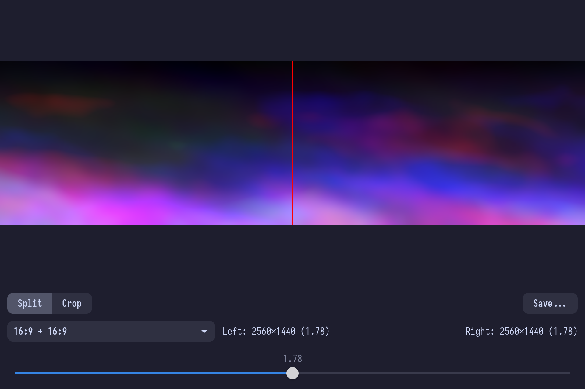
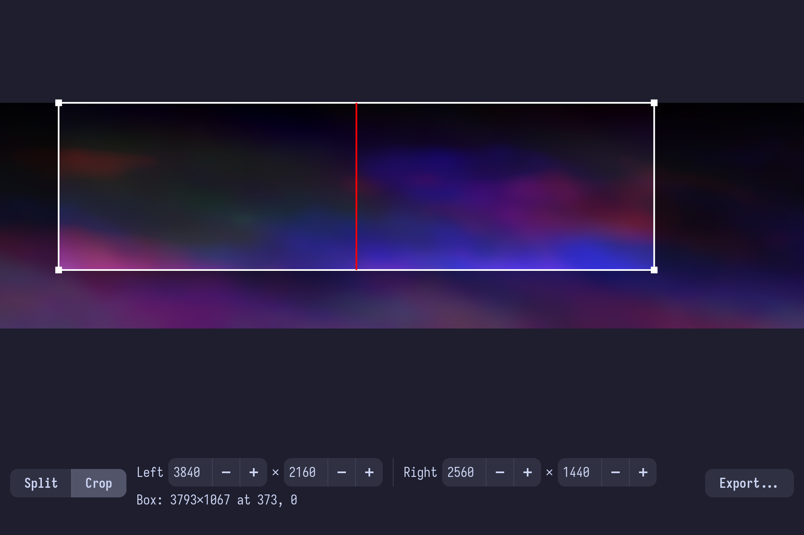

<p align="center">
  
</p>

<h1 align="center">Wall Split</h1>

<p align="center">Cuts one wide wallpaper into two, for two monitors.</p>

> [!WARNING]
> **Certified, artisanal, vibe-coded slop.**
>
> No human has read this code. An AI wrote all of it while a person said "yeah, looks
> good" and pressed Enter a lot. It cuts a picture in two, which is a job for one line
> of ImageMagick, and it does it with a whole GTK window. It only reads the image you give
> it and writes two new files next to wherever you say, so the worst it can do is cut in
> the wrong place.
>
> Bug reports will be read with great affection and then ignored.

| Split mode | Crop mode |
|---|---|
|  |  |

Wall Split (`wall-split`) takes a single wide image, such as a 5120×1440 wallpaper, and
splits it at one vertical cut into a left and a right image. In split mode nothing is cropped or
rescaled: every pixel of the source ends up in exactly one of the two outputs.

## Features

- **Drag and drop:** drop an image on the window to load it, or start it with
  `wall-split image.png`.
- **Pairings:** it lists the monitor ratio pairs that fit the image (16:9 + 16:9,
  16:9 + 32:9, …), with 16:9 + 16:9 first when the image is close to 32:9.
- **A slider** for when no pairing fits, or you just want the cut somewhere else.
- **Crop mode:** pick your two monitors' sizes (filled in from the ones you have), then
  drag a box shaped like them side by side over the part of the image you want. Each half
  is scaled to its monitor's exact resolution.
- **Keys:** <kbd>Ctrl</kbd>+<kbd>1</kbd> split mode, <kbd>Ctrl</kbd>+<kbd>2</kbd> crop mode,
  <kbd>Ctrl</kbd>+<kbd>S</kbd> save. No header bar: it is barless, like the other apps.
- **Save** writes `<name>-left.png` and `<name>-right.png`: in split mode at native
  resolution, in crop mode at your monitors' sizes.

It is early. [`spec/roadmap.md`](spec/roadmap.md) has what is planned, and [`spec/`](spec/README.md)
the honest list of what works.

## Configuration

Optional. On first run Wall Split writes `~/.config/wall-split/config.ini` with every
default commented out. Restart to apply changes.

```ini
[appearance]
flavor = mocha    # latte | frappe | macchiato | mocha | gtk
accent = mauve    # any Catppuccin accent
opacity = 0.85    # window background alpha, 0.0 to 1.0
```

`flavor = gtk` follows the GTK theme instead. Extra CSS goes in
`~/.config/wall-split/style.css`; it can use the palette names (`@base`, `@accent`, …).

## Running

You need Nix with flakes enabled.

```sh
nix run github:DisposableSoftware/wall-split
```

Or from a checkout, `nix build` gives you `./result/bin/wall-split`.

## Development

What Wall Split does is written down in [`spec/`](spec/README.md): every behaviour is a
numbered requirement, and the code follows it. It is a Python and PyGObject app on GTK 4,
with no libadwaita.

```sh
nix develop
pytest
```

The scripts in [`scripts/manual/`](scripts/manual) drive the app to check what unit tests
can't. They run in a headless sway (`scripts/manual/headless.sh`), so they work with the
screen locked.

## Credits

The colours are the [Catppuccin](https://catppuccin.com) palette by the
[Catppuccin community](https://github.com/catppuccin/catppuccin). We only use it.

## License

MIT, see [LICENSE](LICENSE).
